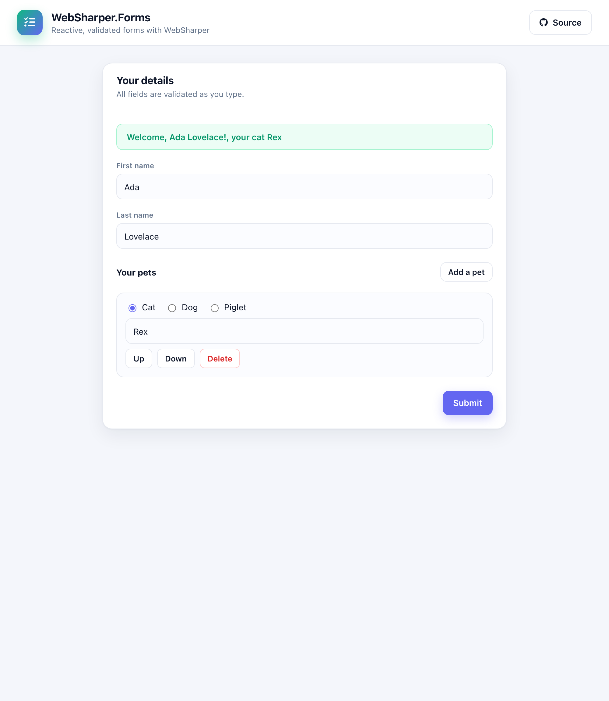

# WebSharper.Forms

A reactive, validated form built with [WebSharper](https://websharper.com) and
[WebSharper.Forms](https://github.com/dotnet-websharper/forms) (reactive forms):
enter your details, add and reorder pets, and submit.

[](https://websharper-samples.github.io/Forms)

**[Try it live](https://websharper-samples.github.io/Forms)**

## What it shows

- Typed, composable forms with `Form.Return` and the applicative `<*>` operator.
- Per-field validation that surfaces errors as you type
  (`Validation.IsNotEmpty`, `submit.View.Through`).
- A dynamic collection of sub-forms with `Form.Many` — add, move up/down and
  delete pets — plus a submit button that is only enabled when the form is valid.

## How it works

- `src/Client.fs` defines the `Person`/`Pet` model and describes the form
  declaratively; `Form.Render` turns it into the WebSharper.UI document that is
  rendered into the page.
- `src/wwwroot/index.html` holds the page header and the styles live in
  `src/wwwroot/css/index.css`.

## Running locally

```
dotnet run --project src
```

Then open <http://localhost:5294>.

## Building

```
dotnet build src/Forms.fsproj -c Release
```

## Deployment

Every push to `master` builds in Release and publishes `src/wwwroot` to the
`gh-pages` branch via `.github/workflows/deploy.yml`.
